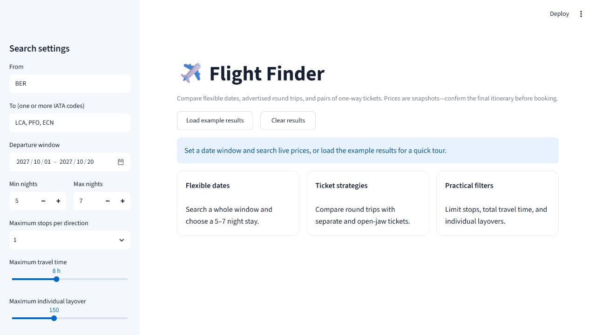
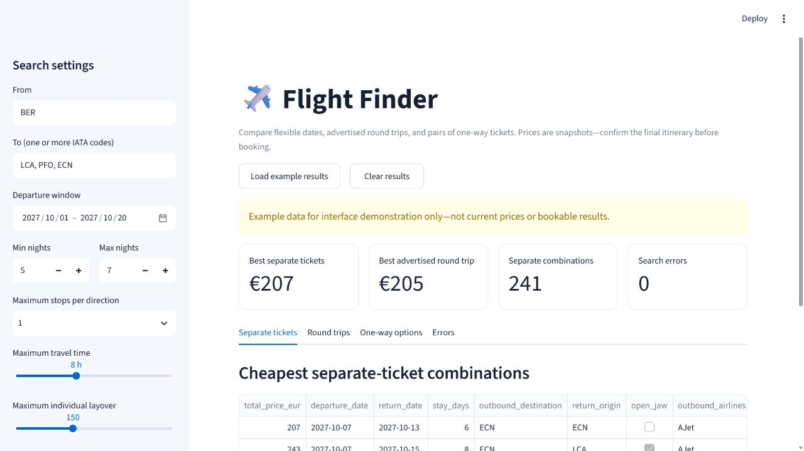

# Flight Finder

Flight Finder searches flexible date ranges, compares advertised round-trip
fares with pairs of one-way tickets, and writes auditable CSV and JSON results.
The primary implementation is `flight_finder_v2.py`.

## Why v2

The repository originally used `google-flights4.p.rapidapi.com`. That version
requires a RapidAPI key and currently fails when the account is not subscribed
to that API. The v2 implementation uses the open-source `fast-flights` client
instead and does not require an API key.

| Capability | Legacy `main.py` | Current `flight_finder_v2.py` + `app.py` |
|---|---|---|
| Data source | RapidAPI subscription | Google Flights via `fast-flights` |
| Interface | Python function | Reproducible CLI plus optional Streamlit UI |
| Destinations | One destination per run | Multiple airports per run |
| Ticket strategies | Round trip or paired one-ways | Round trip, paired one-ways, and open-jaw pairs |
| Constraints | Price and duration | Stops, elapsed duration, individual layover, dates, and stay length |
| Reliability | Retries, no persistent query cache | Retries, concurrent queries, consent handling, persistent cache |
| Outputs | One continuously rewritten CSV | Four CSVs plus a machine-readable summary |
| Return details | Parsed from the RapidAPI returning token | Round-trip return must be confirmed from the generated Google Flights link |

The original `main.py` remains as a historical reference. The current `app.py`
is a dual-mode entry point for the v2 implementation: Streamlit uses it as a
browser interface, while ordinary Python execution falls back to the CLI.

## Installation

Python 3.11 or newer is recommended.

```powershell
py -3 -m venv .venv
.\.venv\Scripts\python.exe -m pip install -r requirements.txt
```

On macOS or Linux, activate the virtual environment with
`source .venv/bin/activate` and use `python` in the commands below.

### Optional browser interface

Install the separate UI requirements and start Streamlit:

```powershell
.\.venv\Scripts\python.exe -m pip install -r requirements-ui.txt
.\.venv\Scripts\python.exe -m streamlit run app.py
```

The form opens at `http://localhost:8501`. It supports multiple destination
airports, a flexible departure window, stay length, stops, total travel time,
individual layover limits, and full or shortlisted round-trip scans. The
**Load example results** button demonstrates the tables without contacting the
flight provider.





## Example search

This example scans Berlin to all three Cyprus airports in October 2027. It
allows at most one stop, eight hours total travel time per direction, and no
individual layover longer than 2 hours 30 minutes.

```powershell
.\.venv\Scripts\python.exe .\flight_finder_v2.py `
  --origin BER `
  --destinations LCA PFO ECN `
  --departure-start 2027-10-01 `
  --departure-end 2027-10-31 `
  --min-stay 5 `
  --max-stay 7 `
  --max-stops 1 `
  --max-duration-minutes 480 `
  --max-layover-minutes 150 `
  --roundtrip-mode full `
  --output-dir .\flight_search_results `
  --cache-dir .\.flight_finder_cache
```

Use `--dry-run` to print the number of planned queries without contacting the
provider. Use `--roundtrip-mode shortlist` for a faster first pass, or `skip`
when only separate one-way combinations are needed.

`app.py` can also be used as the command-line entry point. This works even when
Streamlit is not installed:

```powershell
.\.venv\Scripts\python.exe .\app.py `
  --origin BER `
  --destinations LCA PFO ECN `
  --departure-start 2027-10-01 `
  --departure-end 2027-10-20 `
  --min-stay 5 `
  --max-stay 7 `
  --max-stops 1 `
  --max-duration-minutes 480 `
  --max-layover-minutes 150 `
  --roundtrip-mode full `
  --output-dir .\flight_search_results `
  --cache-dir .\.flight_finder_cache
```

For a quick configuration check, append `--dry-run`. A normal run writes the
ranked separate-ticket combinations, advertised round trips, qualifying
one-way options, errors, and a JSON summary to `flight_search_results`.

## Outputs

The output directory contains:

- `one_way_options.csv`: every qualifying one-way itinerary returned.
- `individual_combinations.csv`: the cheapest pair of one-way tickets for each
  date and airport combination, including open-jaw trips.
- `roundtrip_options.csv`: advertised round-trip totals and the priced outbound.
- `search_errors.csv`: upstream queries that failed after retries.
- `summary.json`: parameters, result counts, timestamps, and cheapest matches.

Each row includes a Google Flights `search_url`. Prices are snapshots and may
change. Always open the link before booking.

## Important limitations

- The default search is for one adult in economy and EUR.
- `fast-flights` exposes the priced outbound for round trips, but Google reveals
  the exact return choice only after selecting that outbound. Confirm the return
  time, stops, layover, and final total in Google Flights.
- Open-jaw combinations can require ground transportation or a border crossing;
  that cost and time are not included.
- The cache does not expire automatically. Use a dated cache directory when a
  fresh price snapshot matters.
- `individual_combinations.csv` chooses the cheapest flight for each leg. When a
  user has time-of-day or airline preferences, filter `one_way_options.csv` and
  recombine the eligible legs.

## Agent workflow

Repository-aware agents should read
`codex_skills/flight-search/SKILL.md` before running a flight search. The skill
defines the broad-scan, shortlist, live-verification, and reporting workflow that
keeps results consistent without manually opening hundreds of date searches.
